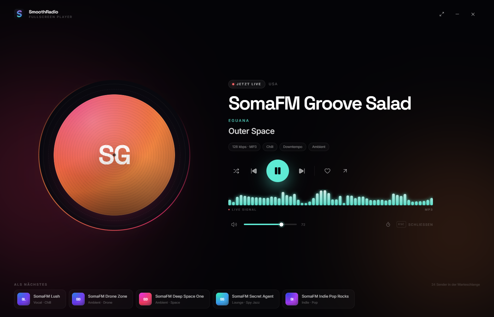
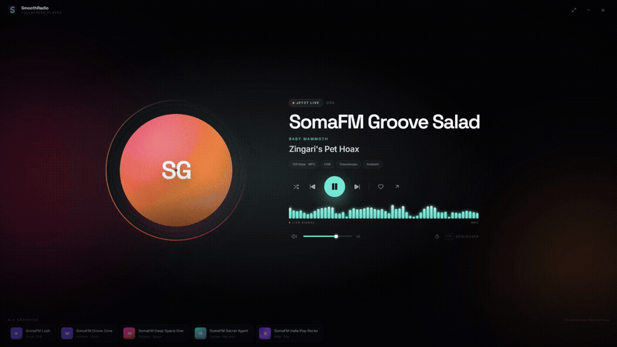

# SmoothRadio

Ein moderner Desktop-Radio-Client für Windows — handverlesene Sender, Live-Metadaten, animiertes Spektrum und **Discord Rich Presence**. Gebaut mit Electron, React, TypeScript und Tailwind.


## Download

[**Windows-Installer & Portable herunterladen**](https://github.com/BellocccYT/smoothradio/releases/latest) · [Zum Quellcode](https://github.com/BellocccYT/smoothradio)

## Features

- **Entdecken** — kuratierte Sender (SomaFM, Radio Paradise, FIP, KEXP, 1LIVE, DLF, Nightride …) plus ~50.000 Sender über die Radio-Browser-API
- **Suche & Genres** — nach Name, Stadt oder Stimmung; acht Genre-Welten
- **Live-Metadaten** — aktuelle Songs via ICY-StreamTitle, automatisch alle 20 s aktualisiert
- **Discord Rich Presence** — Sender, Song und Live-Status im Discord-Profil, inkl. Sender-Button
- **Favoriten, Verlauf, eigene Streams** — lokal gespeichert, kein Konto nötig
- **Fullscreen-Player** — ein immersiver Now-Playing-Modus mit riesigem Vinyl-Artwork, Live-Spektrum, Queue und Discord-Status (`F`)
- **Sleep-Timer, Media-Tasten, Tray** — Radio läuft weiter, wenn das Fenster zu ist
- **Eigenes Design** — Vektor-Logo, Glass-UI, Aurora-Hintergrund, sechs Akzentfarben, animiertes Canvas-Spektrum



## Werbevideo

[](docs/SmoothRadio-Promo.mp4)

[Den 22-Sekunden-Film in 1080p ansehen](docs/SmoothRadio-Promo.mp4) — gebaut mit HyperFrames aus echten App-Aufnahmen.

## Schnellstart (Entwicklung)

```bash
npm install
npm run dev
```

> Falls Electron unter Windows nicht startet, weil `npm` Install-Scripts blockiert:
> `node node_modules/electron/install.js`

## EXE bauen

```bash
npm run dist
```

Ergebnis in `dist/`:

- `SmoothRadio-1.0.0-x64.exe` — One-Click-Installer, per Benutzer (keine Adminrechte, Desktop-Shortcut)
- `SmoothRadio-1.0.0-Portable.exe` — portable Version ohne Installation

Die EXE ist **nicht code-signiert**. Windows SmartScreen zeigt beim ersten Start ggf. „Unbekannter Herausgeber" → *Weitere Informationen* → *Trotzdem ausführen*.

## Discord Rich Presence einrichten

1. [Discord Developer Portal](https://discord.com/developers/applications) öffnen → **New Application**
2. Unter **General Information** die **Application ID** kopieren
3. In SmoothRadio → **Einstellungen** → **Discord Rich Presence** aktivieren, ID einfügen, **Speichern**
4. Optional: Unter **Rich Presence → Art Assets** die Datei `resources/discord-logo.png` als Asset namens `logo` hochladen — dann erscheint das App-Logo im Discord-Profil

Discord Desktop muss auf demselben PC laufen. Bei geschlossenem Discord versucht SmoothRadio automatisch alle 20 Sekunden erneut zu verbinden.


## Shortcuts

| Taste | Aktion |
| --- | --- |
| `Space` | Play / Pause |
| `F` | Fullscreen-Player öffnen / schließen |
| `Esc` | Fullscreen-Player schließen |
| `F11` | Echtes Vollbild umschalten |
| `Ctrl + K` oder `/` | Suche fokussieren |
| `M` | Stummschalten |
| `F12` | DevTools |

Media-Tasten (Play/Pause, Next, Previous) und das Tray-Menü steuern den Player ebenfalls.

## Projektstruktur

```
src/
  main/        Electron-Main: Fenster, Tray, Settings, Discord RPC, ICY-Metadaten
  preload/     typsichere IPC-Bridge (contextBridge)
  renderer/    React-App (Views, Komponenten, Store, Audio-Engine)
  shared/      gemeinsame TypeScript-Typen
resources/     Logo, Tray-Icon, Discord-Asset
scripts/       Icon-Pipeline, Preview-Server, Smoke-Test
```

## Technik

- Electron 45 · React 19 · TypeScript 5.9 · Vite 8 · Tailwind 4
- `@xhayper/discord-rpc` für Rich Presence (IPC, Main-Prozess)
- `hls.js` für `.m3u8`-Streams, nativer MP3/AAC-Support über `<audio>`
- Zustand + Persist für Favoriten/Verlauf/Player-State
- Icons & Logo: handgezeichnetes SVG, per `sharp` zu PNG/ICO gerendert (`npm run icon`)

## Credits

Streams und Metadaten gehören den jeweiligen Sendern. SmoothRadio speichert ausschließlich lokal (Favoriten, Verlauf, Einstellungen) und sendet keine Nutzungsdaten.
